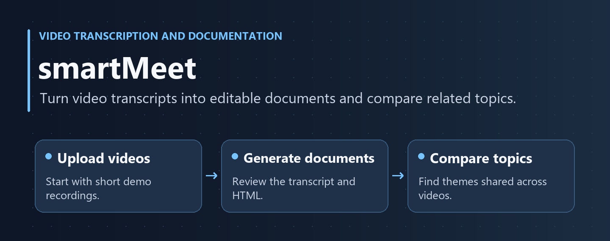

# smartMeet

**Tech stack** · React · Vite · Node.js · Express · MongoDB · Deepgram integration

Turn video transcripts into editable documents and compare related topics.

## What it does

- **Upload videos** · Start with short demo recordings.
- **Generate documents** · Review the transcript and HTML.
- **Compare topics** · Find themes shared across videos.

## Getting started

1. Install packages separately inside `backend/` and `frontend/` with `npm install`.
2. Configure the backend from its source and point it at a local MongoDB instance.
3. Run `npm start` in `backend/` and `npm run dev` in `frontend/`. Use the address printed by Vite.

## Source layout

| Path | Purpose |
| --- | --- |
| `frontend/` | Vite interface for analysis results and saved documents. |
| `backend/` | Express API and MongoDB integration. |
| `frontend/src/components/OverlapModal.jsx` | Interface for comparing overlapping topics. |

## Tests and verification

- Inside `frontend/`, run `npm run lint` and `npm run build`. The backend `test` script is a placeholder.
- Analyze two short samples with one shared topic and verify that both results and the comparison view appear.
- Stop the API briefly and check whether the interface surfaces the failed request.

The upstream source has no working automated test suite detected.

## Keeping installs reproducible

The frontend and backend have separate npm manifests and installs. Run `npm install` inside each folder for the initial setup. Preserve the `package-lock.json` generated in each folder alongside that folder’s `package.json` when you verify and commit a dependency change.

Once a package has a committed lockfile, run `npm ci` inside that package for a clean install of the versions recorded there.

## Credits and license

ISC is declared in `backend/package.json`. Confirm the permission and notices for the full repository and its assets before standalone redistribution.

[Original repository](https://github.com/Pradeep-Polishetty/smartMeet) · `Pradeep-Polishetty` and upstream contributors
